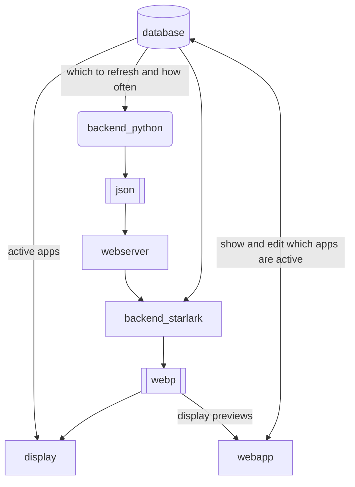
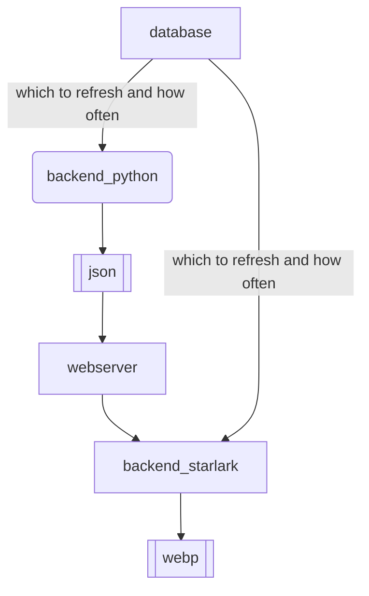

# pheonix
Code to drive a passive led matrix display built on top of tidbyt.


# Architechture

The architecture is described in the graph below. There are four main components:

- the **rendering engine** (backend), which is responsible for generating webp images or animations that the display can use
- the **display code**, which
  - interfaces with the matrix low level code
  - provides high level utiulities for controlling what gets displayed
- the **webapp**, which provides a simple interface to control what gets displayed
- the **database**, which allows these separate processes to communicate.





Let's describe each piece in more detail.

## Rendering engine

The rendering engine takes information from a variety of inputs and produces `webp` images (static ones, or `webp` also supports animated ones, akin to a `gif`).



As you can see above, there are two code paths to arrive at the webp. Let's examine the right path first.

### Applets using only starlark
This is the most frequently used path to generate webp's. In this path, the rendering code will call a the `pixlet` code via a subprocess in a loop forever. Each app is running in a separate thread. Pixlet is evaluated on the starlark code for that applet using `pixlet render applet.star`, which generates a webp. It's actually called twice, once, to generate the small scale version for the device, and once to generate a 5x larger one for use in the web UI.

### Applets using the python backend preprocessors
The code path using only starlark is enough for most simple applications. For more complex applications however, pixlet / starlark limitations get in the way. Some limitations are:

- There is no good way of loading local files. Everything must be hosted and retrieved via a http call.
- We don't get any of the fantastic python libraries with starlark. We end up having to re-implement code from fantastic python libraries like `spotipy` or others.

Due to these restrictions, there is an optional secondary code path we provide. This one first calls a python script, which will do any part of the rendering process for you, but typically just the first data gathering, since the display rendering portion is conveniant to do using starlark's libraries. This python process must write a `json` file to the `data` folder of the repo. This json file is then loaded and parsed by the pixlet starlark code. However, since starlark cannot read from the file system, the contents of the `data` folder are served on a python microserver on localhost, such that pixlet can get the contents with an http call.

This is s


# Startup

To start the app, a few services must be ran. The description of each and their roles is below.

## Docker compose

TODO

## mprocs

Mprocs is a process runner similar to tmux, but better suited for observing long running non interactive processes. Perfect for what we need.

The config of what to run is in `mprocs.yaml`. Run with a simple `mprocs` out of the root project folder.


# Services
## Simple HTTP server
Starlark is a rather limiting subset of python. Many operations, such as getting data from spotify, are much quicker to implement in full python. So the idea is that the rendering step that produces the webp images is actually a sequence of two steps: an optional python step that emits some data, followed by a starlark step that either fetches the data by iteslf or grabs it from the python process that preceeded it.

Since pixlet apps are very limited in their ability to read local files.- a simple http server runnning on localhost, serving any external data to starlark.


```
python http_server.py
```

## Rednering loop
```
python render.py
```

## Display loop
This must be ran with sudeo to get the best display resutls. Don't worry, the elevated permissions are dropped as soon as the matrix control code is loaded.

```
sudo env/bin/python display.py
```


# TODO
- check if I need to set up the library for the hat to enable the real time clock thing now that I put the battery in
- make an applet for http://programmingexcuses.com/