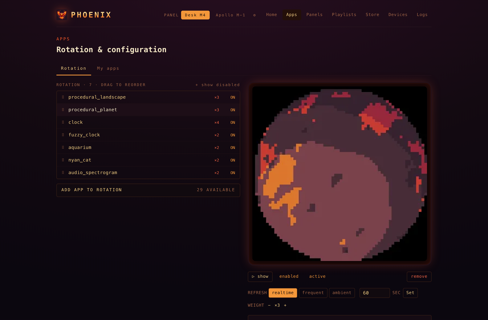
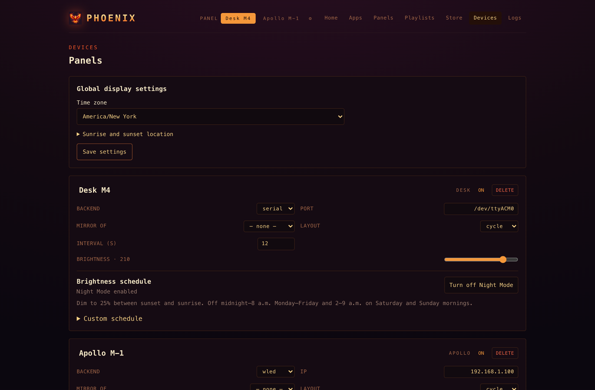

<p align="center">
  
</p>

<h1 align="center">Phoenix</h1>

<p align="center">
  <strong>Self-hosted 64×64 LED matrix display manager — an open-source Tidbyt successor for WLED &amp; HUB75 panels.</strong>
</p>

<p align="center">
  <a href="https://github.com/charlesbine/phoenix/actions/workflows/ci.yml"></a>
  <a href="LICENSE"></a>
  
  
</p>

---

<p align="center">
  
  <br />
  <sub><em>The 152 × 152 × 55 mm stained mitered-plywood shadowbox running <code>procedural_landscape</code> (peaks / aurora). Full disclosure: studio-lit AI re-shoot of the real wooden box and real Phoenix pixel art because I couldn't be bothered to clean my desk for a product photo — <a href="docs/media/shadowbox-back.jpg">unvarnished real side profile here</a>.</em></sub>
</p>

<p align="center">
  
</p>

---

## Why Phoenix?

Phoenix started in April 2023 as a fully local 64×64 Tidbyt alternative mounted inside a hand-stained and lacquered wooden shadowbox. Because everything renders and plays locally without a cloud server, it kept running right through Tidbyt's November 2024 discontinuation without skipping a beat. It later absorbed a standalone WLED controller for plug-and-play panels like the Apollo M-1, unifying DIY HUB75 builds and off-the-shelf WLED matrices under one Ember-CRT dashboard, 970+ community apps, and procedural pixel worlds.

- **Tidbyt / Pixlet Compatible** — Run hundreds of Starlark community apps from [`charlesbine/phoenix-apps`](https://github.com/charlesbine/phoenix-apps) (installed right from the built-in Store) alongside native Python/Pillow apps with zero limitations.
- **Ember-CRT Web Dashboard** — Manage every panel from a live WebSocket-powered Vue 3 dashboard: real-time preview, quick per-app settings, weighted priority cycling (`1×–4×`), Single-App pinning, Show Now interrupts, playlists, and diagnostics.
- **Multi-Panel Fleet** — Drive WLED panels over LAN DDP and Matrix Portal M4 panels over USB serial from one controller. Each panel keeps its own rotation, layout mode (`cycle`, `random`, `single`), brightness schedule, or mirrors another panel.
- **Live 60 FPS Audio Visualizer** — Real-time FFT spectrum (`bars`, `vu`, `spectrogram`) with selectable palettes (`Hue heat`, `Fire`, `Ice`, `Aurora`, `Mono`) driven by a USB mic or audio loopback.
- **Solar-Aware Night Mode** — Automatically dims panels to 25% between sunset and sunrise and powers them off overnight (or follows your custom schedule), persisted locally on paired display nodes so schedules keep working even during server outages.
- **Procedural Pixel Art Built In** — Seamless looping **Procedural Landscape** (12 palettes × 6 terrain archetypes with aurora, synthwave sun, ringed planets, dramatic coastlines, Monument Valley mesas, sweeping dunes, and molten lava worlds), continuously rotating **Procedural Planet**, animated **Christmas Countdown**, **Home Climate**, **Spotify Now Playing**, and **MQTT Package Alerts**.
- **Home Assistant & MQTT Native** — Auto-discovers as a dimmable light in Home Assistant with effect/app switching, pulls live media now-playing, and supports instant MQTT interrupt notifications.
- **6-Bit sRGB Color & Hardware OE Dimming (M4)** — Custom Matrix Portal M4 firmware with sRGB-to-linear LUTs and hardware `TCC0` OE pulse brightness modulation so low-brightness night frames stay smooth and color-accurate.

---

## Hardware Options

Pick the path that fits your desk — no hardware is required to try Phoenix in browser preview mode first.

| Path | Hardware | Setup Effort | Connection | Best For | Guide |
|---|---|---|---|---|---|
| **Recommended Easy Path** | **[Apollo Automation M-1](https://apolloautomation.com/products/m-1-led-matrix)** (or any 64×64 ESP32 WLED matrix) | ~10 min — zero soldering or flashing | Wi-Fi / LAN (DDP UDP `4048`) | Easiest way into the LED matrix world — plug-and-play desk display managed from any Mac, Linux box, or home server | [Apollo M-1 & WLED Guide](docs/hardware/apollo-m1-wled.md) |
| **DIY HUB75 Build** | **64×64 P2/P2.5 HUB75E panel** + **Adafruit Matrix Portal M4** + 5V 4A PSU | ~30 min — 1 solder jumper + `just flash-m4` | USB-C serial to Pi / mini-PC / Mac | Maximum color fidelity (6-bit sRGB + hardware OE dimming), custom enclosures, optional SCD40 CO₂ sensor | [Matrix Portal M4 Guide](docs/hardware/matrix-portal-m4.md) |
| **No Hardware Yet** | Any laptop or server | 60 seconds | Browser (`PHOENIX_PLATFORM=web`) | Trying the dashboard, developing Starlark/Python applets | [60-Second Quick Start](#60-second-quick-start) |

---

## 60-Second Quick Start

### Option 1: Docker Compose (Fastest)

```bash
git clone https://github.com/charlesbine/phoenix.git
cd phoenix
cp .env.example .env
docker compose up -d --build
```

Open **`http://localhost:7002`** — the Ember-CRT dashboard is live. Add a WLED panel in **Devices** (or switch `.env` to `PHOENIX_PLATFORM=wled` / `serial`) to push frames to real hardware.

### Option 2: Local Dev Preview (macOS / Linux)

Requires Python 3.11+, [`uv`](https://docs.astral.sh/uv/), [`bun`](https://bun.sh/), and [`pixlet`](https://github.com/tidbyt/pixlet/releases):

```bash
git clone https://github.com/charlesbine/phoenix.git
cd phoenix
cp .env.example .env
uv sync
cd frontend && bun install --frozen-lockfile && bun run build && cd ..
PHOENIX_PLATFORM=web uv run phoenix dashboard
```

In a second terminal, run `PHOENIX_PLATFORM=web uv run phoenix render` to continuously render enabled applets.

---

## Dashboard Tour

<table>
  <tr>
    <td width="50%">
      <strong>Apps &amp; Live Configurator</strong><br />
      Manage your rotation, adjust per-app weights and refresh presets, and tweak app settings with instant re-render.<br /><br />
      
    </td>
    <td width="50%">
      <strong>Multi-Panel Fleet &amp; Night Mode</strong><br />
      Register WLED and serial panels side by side, configure solar-aware Night Mode, or define custom brightness schedules.<br /><br />
      
    </td>
  </tr>
  <tr>
    <td colspan="2">
      <strong>Community App Store</strong><br />
      Browse, filter by category, and one-click import hundreds of Starlark applets from <code>charlesbine/phoenix-apps</code>.<br /><br />
      
    </td>
  </tr>
</table>

---

## Architecture

Phoenix runs in two topologies from the same codebase and container image (`PHOENIX_SERVICES` selects which processes run):

**All-in-One** — one machine renders applets, hosts the dashboard, and drives your panel(s):

```text
Host (dashboard + render + display) ──┬── LAN DDP UDP ───▶ Apollo M-1 / WLED panel
                                      └── USB serial ────▶ Matrix Portal M4 ──▶ 64×64 HUB75
```

**Split (Controller + Paired Serial Node)** — keep heavy Starlark/Python rendering on a home server while a 1 GB Raspberry Pi runs only the lightweight native `phoenix node` display player:

```text
Home Server (Docker)                             USB Display Host (native systemd)
[dashboard + render] ── private HTTPS push ───▶  [phoenix node: display + local audio] ── USB ──▶ M4 ──▶ Panel
```

The paired display node persists its accepted rotation, Night Mode settings, and rendered 64×64 WebPs to disk so playback continues seamlessly across restarts and server outages. See **[`docs/deployment.md`](docs/deployment.md)** for Docker Compose, systemd (`deploy/install.sh`), and split-node TLS pairing instructions.

---

## Built-In Apps & Writing Your Own

Phoenix supports four applet types out of the box:

1. **Starlark (`.star`)** — Drop any Tidbyt/Pixlet-compatible `.star` file into `phoenix/apps/` (or import from the **Store** tab). Starlark `get_schema()` fields automatically appear in the dashboard settings UI.
2. **Python (`.py`)** — Full Pillow/Python rendering with zero sandbox limits. Built-in Python apps include:
   - `procedural_landscape` — Seamless 12-second looping anti-aliased generative terrain flyover (12 LED-tuned palettes × 6 terrain archetypes, `auto` random worlds)
   - `procedural_planet` — Continuously rotating procedural planets with bounded smooth animation timing
   - `christmas_countdown` — Animated snowfall, sleigh, gift-pop, and shooting-star interludes
   - `home_climate` — Multi-room temperature & humidity dashboard from configurable Home Assistant sensors
   - `spotify` — Full-screen album art + song progress frame from Home Assistant `media_player` entities
   - `packages` — Conditional MQTT package delivery alert (automatically skips rotation when count is `0`)
3. **Live Real-Time Apps** — `audio_bars`, `audio_vu`, `audio_spectrogram` (60 FPS FFT audio visualizer) and live now-playing.
4. **Static Media & Custom Panels** — Drop `.webp`, `.gif`, or `.png` files directly, or build custom multi-stat / sparkline / key-value panels in the **Panels** tab.

---

## Configuration & API

Copy [`.env.example`](.env.example) to `.env` to configure your display backend, optional Home Assistant / MQTT integrations, audio input device, or split-node pairing.

| Endpoint | Description |
|---|---|
| `GET /` | Ember-CRT Web Dashboard (Vue 3 SPA) |
| `WS /ws/state?device=...` | Live state push (now-playing, rotation, brightness, Night Mode phase) |
| `GET /api/devices` | List / create / update panels and brightness schedules |
| `GET /api/apps?device=...` | List per-panel rotation, weights, and app configs |
| `POST /api/apps/{name}/preview` | Re-render an app with saved settings |
| `POST /api/apps/{name}/show` | Interrupt current cycle and show an app immediately |
| `POST /api/notify` | Push a temporary text/icon notification interrupt |
| `GET /api/status` | System health, paired player sync status, and diagnostics |
| `GET /proxy?url=...&ttl=300` | SSRF-hardened SQLite HTTP cache proxy for Starlark applets |

---

## Development

```bash
# Run Python test suite
uv run pytest

# Typecheck & build Vue dashboard
cd frontend && bun run build

# Run host C++ checks for M4 color & OE timing math
c++ -std=c++11 -Wall -Wextra -Werror firmware/tests/panel_color_test.cpp -o /tmp/panel-color-test
/tmp/panel-color-test
```

## License

MIT — see [`LICENSE`](LICENSE).
