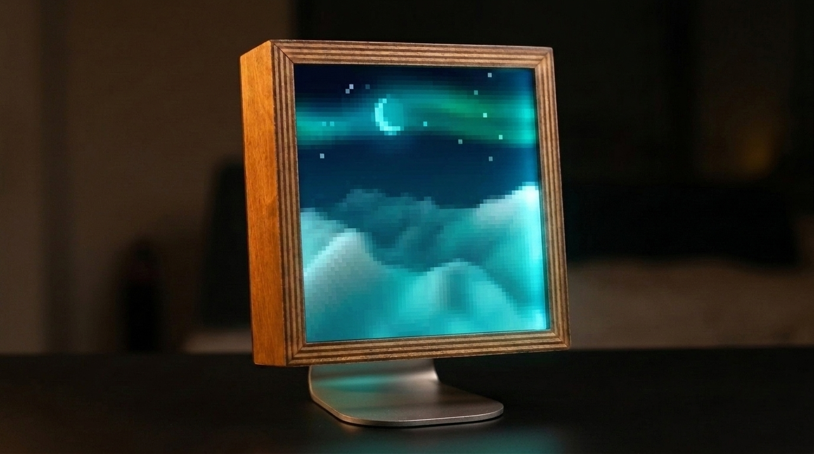
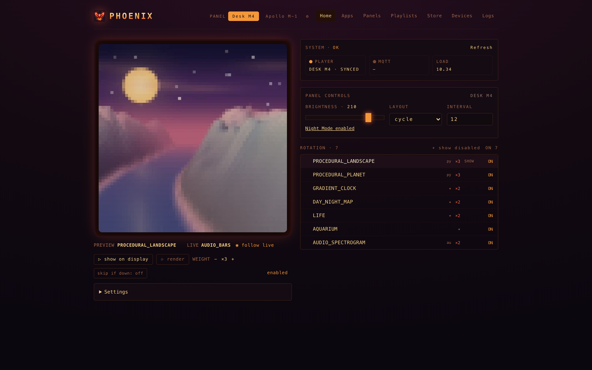
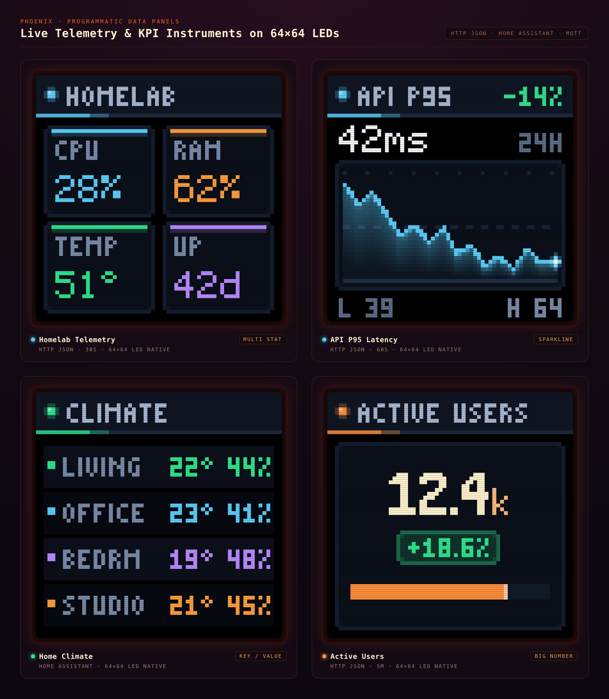
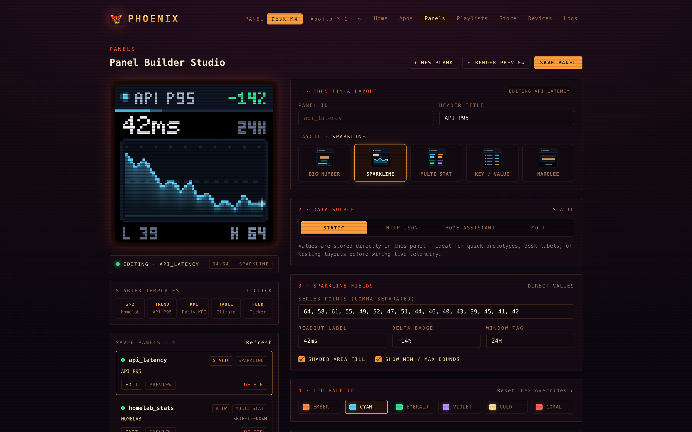
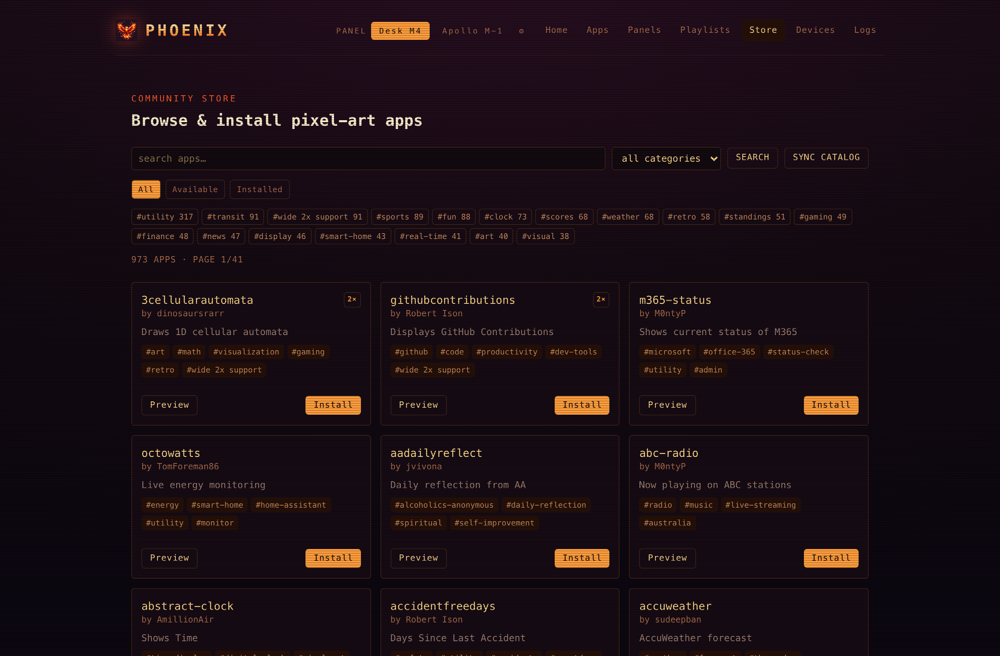
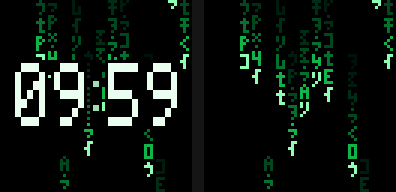

<p align="center">
  
</p>

<h1 align="center">Phoenix</h1>

<p align="center">
  <strong>Self-hosted 64×64 LED matrix display manager — an open-source Tidbyt successor for WLED &amp; HUB75 panels.</strong>
</p>

<p align="center">
  <a href="https://github.com/charlesbine/phoenix/actions/workflows/ci.yml"></a>
  <a href="LICENSE"></a>
  
  
</p>

---

<p align="center">
  
  <br />
  <sub><em>The 152 × 152 × 55 mm stained mitered-plywood shadowbox running <code>procedural_landscape</code> (peaks / aurora). Full disclosure: studio-lit AI re-shoot of the real wooden box and real Phoenix pixel art because I couldn't be bothered to clean my desk for a product photo — <a href="docs/media/shadowbox-back.jpg">unvarnished real side profile here</a>.</em></sub>
</p>

<p align="center">
  
</p>

---

## Why Phoenix?

Phoenix started in April 2023 as a fully local 64×64 Tidbyt alternative mounted inside a hand-stained and lacquered wooden shadowbox. Because everything renders and plays locally without a cloud server, it kept running right through Tidbyt's November 2024 discontinuation without skipping a beat. It later absorbed a standalone WLED controller for plug-and-play panels like the Apollo M-1, unifying DIY HUB75 builds and off-the-shelf WLED matrices under one Ember-CRT dashboard, 970+ community apps, and procedural pixel worlds.

- **Tidbyt / Pixlet Compatible** — Run hundreds of Starlark community apps from [`charlesbine/phoenix-apps`](https://github.com/charlesbine/phoenix-apps) (installed right from the built-in Store) alongside native Python/Pillow apps with zero limitations.
- **Ember-CRT Web Dashboard** — Manage every panel from a live WebSocket-powered Vue 3 dashboard: real-time preview, quick per-app settings, weighted priority cycling (`1×–4×`), Single-App pinning, Show Now interrupts, playlists, and diagnostics.
- **Multi-Panel Fleet** — Drive WLED panels over LAN DDP and Matrix Portal M4 panels over USB serial from one controller. Each panel keeps its own rotation, layout mode (`cycle`, `random`, `single`), brightness schedule, or mirrors another panel.
- **Live 60 FPS Audio Visualizer** — Real-time FFT spectrum (`bars`, `vu`, `spectrogram`) with selectable palettes (`Hue heat`, `Fire`, `Ice`, `Aurora`, `Mono`) driven by a USB mic or audio loopback.
- **Solar-Aware Night Mode** — Automatically dims panels to 25% between sunset and sunrise and powers them off overnight (or follows your custom schedule), persisted locally on paired display nodes so schedules keep working even during server outages.
- **Procedural Pixel Art Built In** — Seamless looping **Procedural Landscape** (12 palettes × 6 terrain archetypes with aurora, synthwave sun, ringed planets, dramatic coastlines, Monument Valley mesas, sweeping dunes, and molten lava worlds), continuously rotating **Procedural Planet**, animated **Christmas Countdown**, **Home Climate**, **Spotify Now Playing**, and **MQTT Package Alerts**.
- **Home Assistant & MQTT Native** — Auto-discovers as a dimmable light in Home Assistant with effect/app switching, pulls live media now-playing, and supports instant MQTT interrupt notifications.
- **6-Bit sRGB Color & Hardware OE Dimming (M4)** — Custom Matrix Portal M4 firmware with sRGB-to-linear LUTs and hardware `TCC0` OE pulse brightness modulation so low-brightness night frames stay smooth and color-accurate.

---

## Hardware Options

Pick the path that fits your desk — no hardware is required to try Phoenix in browser preview mode first.

| Path | Hardware | Setup Effort | Connection | Best For | Guide |
|---|---|---|---|---|---|
| **Recommended Easy Path** | **[Apollo Automation M-1](https://apolloautomation.com/products/m-1-led-matrix)** (or any 64×64 ESP32 WLED matrix) | ~10 min — zero soldering or flashing | Wi-Fi / LAN (DDP UDP `4048`) | Easiest way into the LED matrix world — plug-and-play desk display managed from any Mac, Linux box, or home server | [Apollo M-1 & WLED Guide](docs/hardware/apollo-m1-wled.md) |
| **DIY HUB75 Build** | **64×64 P2/P2.5 HUB75E panel** + **Adafruit Matrix Portal M4** + 5V 4A PSU | ~30 min — 1 solder jumper + `just flash-m4` | USB-C serial to Pi / mini-PC / Mac | Maximum color fidelity (6-bit sRGB + hardware OE dimming), custom enclosures, optional SCD40 CO₂ sensor | [Matrix Portal M4 Guide](docs/hardware/matrix-portal-m4.md) |
| **No Hardware Yet** | Any laptop or server | 60 seconds | Browser (`PHOENIX_PLATFORM=web`) | Trying the dashboard, developing Starlark/Python applets | [60-Second Quick Start](#60-second-quick-start) |

---

## 60-Second Quick Start

### Option 1: Docker Compose (Fastest)

```bash
git clone https://github.com/charlesbine/phoenix.git
cd phoenix
cp .env.example .env
docker compose up -d --build
```

Open **`http://localhost:7002`** — the Ember-CRT dashboard is live. Add a WLED panel in **Devices** (or switch `.env` to `PHOENIX_PLATFORM=wled` / `serial`) to push frames to real hardware.

### Option 2: Local Dev Preview (macOS / Linux)

Requires Python 3.11+, [`uv`](https://docs.astral.sh/uv/), [`bun`](https://bun.sh/), and [`pixlet`](https://github.com/tidbyt/pixlet/releases):

```bash
git clone https://github.com/charlesbine/phoenix.git
cd phoenix
cp .env.example .env
uv sync
cd frontend && bun install --frozen-lockfile && bun run build && cd ..
PHOENIX_PLATFORM=web uv run phoenix dashboard
```

In a second terminal, run `PHOENIX_PLATFORM=web uv run phoenix render` to continuously render enabled applets.

---

## Dashboard & Data Showcase

Phoenix isn't just for ambient pixel art — it includes a pure-Python **Programmatic Panel Builder** that turns any HTTP JSON endpoint, Home Assistant entity, or MQTT topic into crisp 64×64 hardware telemetry instruments (`multi_stat`, `sparkline`, `key_value`, `big_number`, `marquee`).

<p align="center">
  
</p>

<table>
  <tr>
    <td colspan="2">
      <strong>Panel Builder Studio</strong><br />
      Design live data panels without writing code: pick a layout wireframe, wire an HTTP JSON / Home Assistant / MQTT source with dot-path mappings and transforms, choose LED-tuned colors, and preview instantly on the glowing 64×64 CRT monitor.<br /><br />
      
    </td>
  </tr>
  <tr>
    <td width="50%">
      <strong>Apps &amp; Live Configurator</strong><br />
      Manage your rotation, adjust per-app weights and refresh presets, and tweak app settings with instant re-render.<br /><br />
      
    </td>
    <td width="50%">
      <strong>Multi-Panel Fleet &amp; Night Mode</strong><br />
      Register WLED and serial panels side by side, configure solar-aware Night Mode, or define custom brightness schedules.<br /><br />
      
    </td>
  </tr>
  <tr>
    <td colspan="2">
      <strong>Community App Store</strong><br />
      Browse, filter by category, and one-click import hundreds of Starlark applets from <code>charlesbine/phoenix-apps</code>.<br /><br />
      
    </td>
  </tr>
</table>

---

## Architecture

Phoenix runs in two topologies from the same codebase and container image (`PHOENIX_SERVICES` selects which processes run):

**All-in-One** — one machine renders applets, hosts the dashboard, and drives your panel(s):

```text
Host (dashboard + render + display) ──┬── LAN DDP UDP ───▶ Apollo M-1 / WLED panel
                                      └── USB serial ────▶ Matrix Portal M4 ──▶ 64×64 HUB75
```

**Split (Controller + Paired Serial Node)** — keep heavy Starlark/Python rendering on a home server while a 1 GB Raspberry Pi runs only the lightweight native `phoenix node` display player:

```text
Home Server (Docker)                             USB Display Host (native systemd)
[dashboard + render] ── private HTTPS push ───▶  [phoenix node: display + local audio] ── USB ──▶ M4 ──▶ Panel
```

The paired display node persists its accepted rotation, Night Mode settings, and rendered 64×64 WebPs to disk so playback continues seamlessly across restarts and server outages. See **[`docs/deployment.md`](docs/deployment.md)** for Docker Compose, systemd (`deploy/install.sh`), and split-node TLS pairing instructions.

---

## Four Ways to Build for Phoenix

Phoenix supports four distinct tiers of apps and data panels — start with zero code in the browser and reach for Starlark, native Python, or 60 FPS live generators whenever you want full pixel control:

### 1. Programmatic Custom Panels (No Code)

Open the **Panels** tab to build live data displays directly in the Ember-CRT **Panel Builder Studio** — no code, no Pixlet sandbox, rendered natively with crisp pixel typography in milliseconds:

- **Five hardware-styled layouts:**
  - `big_number` — Hero metric with unit, auto-colored delta pill (`+18.6%` / `-2.1%`), subtitle, and optional goal progress bar
  - `sparkline` — Full-width shaded area curve with dashed midline, white-hot latest-point beacon, delta badge, and min/max bounds
  - `multi_stat` — Structured 2×2 (or 2×1) dark slate metric tiles with color-coded top accent stripes
  - `key_value` — Banded telemetry table with per-row status pips and right-aligned tabular values
  - `marquee` — Framed hardware ticker tape with smooth animated WebP scrolling
- **Live data ingress:** Connect to **HTTP JSON** (with Bearer, API-key, or Basic auth stored redacted in SQLite), **Home Assistant** entity states, **MQTT** topics, or **Static** values.
- **Dot-path extraction & transforms:** Extract nested fields (e.g. `metrics.latency.p95`, `series.0.value`), chain safe transforms (`/ 100 | round 1 | format $%.1f`), and enable **`skip_when_unhealthy`** + `stale_after` so broken or stale feeds automatically drop out of your rotation until they recover.

### 2. Starlark Applets (`.star` — Tidbyt / Pixlet Compatible)

Drop any Tidbyt/Pixlet-compatible `.star` file into `phoenix/apps/` or one-click import from **970+ community apps** mirrored in [`charlesbine/phoenix-apps`](https://github.com/charlesbine/phoenix-apps) via the **Store** tab. Any `get_schema()` fields you define are automatically rendered as form controls in the dashboard:

```python
load("render.star", "render")
load("schema.star", "schema")

def main(config):
    label = config.get("label", "PHOENIX")
    return render.Root(
        child = render.Box(
            child = render.Text(content = label, font = "6x13", color = "#FF9E3D"),
        ),
    )

def get_schema():
    return schema.Schema(
        version = "1",
        fields = [
            schema.Text(id = "label", name = "Label", desc = "Text to display", default = "PHOENIX"),
        ],
    )
```

### 3. Native Python Apps (`.py` — Zero Sandbox Limits)

For shaders, Pillow compositing, async APIs, or conditional alerts, drop a `.py` file into `phoenix/apps/` implementing an optional `SETTINGS_SCHEMA` list and `render(settings, config, output, output_large)`:

```python
from pathlib import Path
from PIL import Image, ImageDraw
from phoenix.settings import Settings

SETTINGS_SCHEMA = [
    {"id": "accent", "name": "Accent Color", "type": "color", "default": "#5BCEFA"},
]

def render(settings: Settings, config: dict[str, str], output: Path, output_large: Path) -> None:
    img = Image.new("RGB", (settings.render_width, settings.render_height), (0, 0, 0))
    draw = ImageDraw.Draw(img)
    draw.rectangle([4, 4, 59, 59], outline=config.get("accent", "#5BCEFA"))
    img.save(output, "WEBP", lossless=True)
    img.resize(
        (settings.render_width * settings.magnification, settings.render_height * settings.magnification),
        Image.Resampling.NEAREST,
    ).save(output_large, "WEBP", lossless=True)
```

For Matrix-style digital rain, open **Apps**, select a device and choose **Add app to rotation**.
Choose `matrix_rain` for streams of green terminal glyphs, or `matrix_clock`
for a 24-hour clock over the rain. In the last 2.2 seconds of each minute, the changing digits cycle through bright
code glyphs while the rain behind them quickens. They settle into the new time
on the minute, inspired by [AnimatedPixelClock style 12](https://github.com/Keralots/AnimatedPixelClock#hour-change-animations). Both run on the player. The clock uses the time
zone in Phoenix display settings, including on a paired node playing offline.
Open either app’s **Settings** to set **Rain speed** (0.5× to 8×) and **Rain density**
(Sparse, Normal or Dense). Each app saves its own choices across panels. The
defaults are 1× and Normal. Rain speed affects the streams only; the clock
always finishes its decode on the minute.



Built-in Python apps include:
- `procedural_landscape` — Seamless 12-second looping anti-aliased generative terrain flyover (12 LED-tuned palettes × 6 terrain archetypes, `auto` random worlds)
- `procedural_planet` — Continuously rotating procedural planets with bounded smooth animation timing
- `christmas_countdown` — Animated snowfall, sleigh, gift-pop, and shooting-star interludes
- `home_climate` — Multi-room temperature & humidity dashboard from configurable Home Assistant sensors
- `spotify` — Full-screen album art + song progress frame from Home Assistant `media_player` entities
- `packages` — Conditional MQTT package delivery alert (automatically skips rotation when count is `0`)

### 4. Live 60 FPS Generators & Static Media

- **Real-time 60 FPS audio visualizers** (`audio_bars`, `audio_vu`, `audio_spectrogram`) driven by a USB mic or audio loopback with live palette switching (`Hue heat`, `Fire`, `Ice`, `Mono`, and more).
- **Live now-playing** (`media_player`) streaming album art and track progress directly to the panel without waiting on render intervals.
- **Static & animated media drops:** Place any `.webp`, `.gif`, or `.png` file into `phoenix/apps/` and add it directly to any panel's rotation or playlist.

---

## Configuration & API

Copy [`.env.example`](.env.example) to `.env` to configure your display backend, optional Home Assistant / MQTT integrations, audio input device, or split-node pairing.

| Endpoint | Description |
|---|---|
| `GET /` | Ember-CRT Web Dashboard (Vue 3 SPA) |
| `WS /ws/state?device=...` | Live state push (now-playing, rotation, brightness, Night Mode phase) |
| `GET /api/devices` | List / create / update panels and brightness schedules |
| `GET /api/apps?device=...` | List per-panel rotation, weights, and app configs |
| `POST /api/apps/{name}/preview` | Re-render an app with saved settings |
| `POST /api/apps/{name}/show` | Interrupt current cycle and show an app immediately |
| `POST /api/notify` | Push a temporary text/icon notification interrupt |
| `GET /api/status` | System health, paired player sync status, and diagnostics |
| `GET /proxy?url=...&ttl=300` | SSRF-hardened SQLite HTTP cache proxy for Starlark applets |

---

## Development

```bash
# Run Python test suite
uv run pytest

# Typecheck & build Vue dashboard
cd frontend && bun run build

# Run host C++ checks for M4 color & OE timing math
c++ -std=c++11 -Wall -Wextra -Werror firmware/tests/panel_color_test.cpp -o /tmp/panel-color-test
/tmp/panel-color-test
```

## Credits & License

- **Procedural Planet (`procedural_planet` / `pixel_planet`):** Re-implements the shader algorithms from Deep-Fold's **[Pixel Planet Generator](https://deep-fold.itch.io/pixel-planet-generator)** ([`Deep-Fold/PixelPlanets`](https://github.com/Deep-Fold/PixelPlanets), MIT License). See [`THIRD_PARTY_LICENSES.md`](THIRD_PARTY_LICENSES.md).
- **Tidbyt / Pixlet & Tronbyt Ecosystem:** Starlark rendering via [Pixlet](https://github.com/tidbyt/pixlet) and community catalog mirrored from [`tronbyt/apps`](https://github.com/tronbyt/apps).

MIT — see [`LICENSE`](LICENSE).
