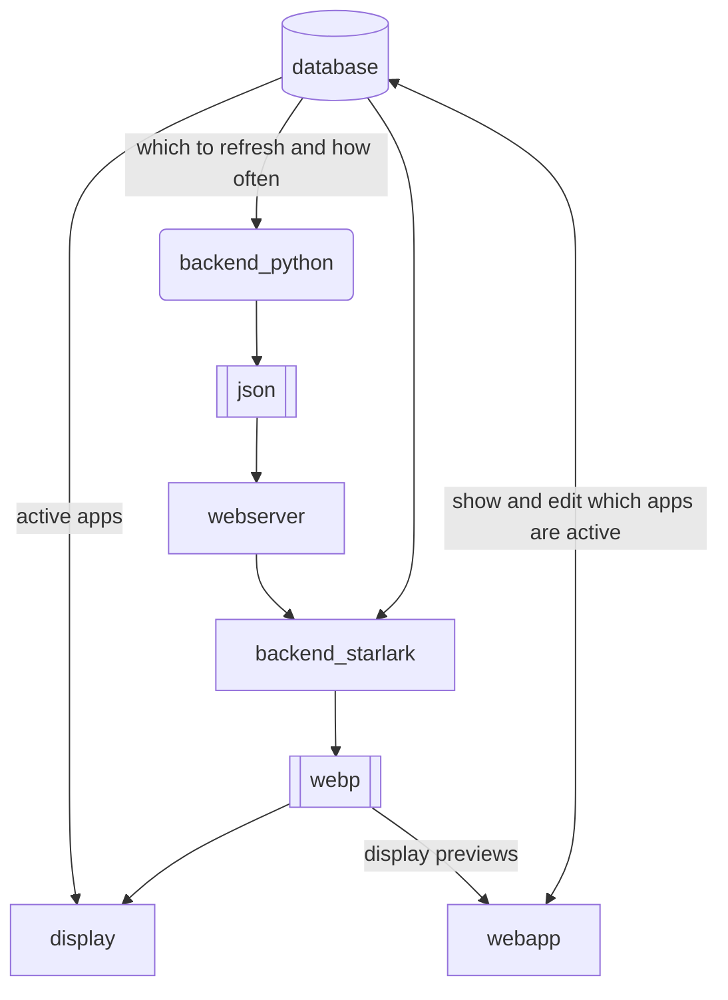

# pheonix
Code to drive a passive led matrix display built on top of tidbyt


# Architechture

The architecture is described in the graph below. 



# Sartup

To start the app, a few services must be ran:

## Simple HTTP server 
Starlark is a rather limiting subset of python. Many operations, such as getting data from spotify, are much quicker to implement in full python. So the idea is that the rendering step that produces the webp images is actually a sequence of two steps: an optional python step that emits some data, followed by a starlark step that either fetches the data by iteslf or grabs it from the python process that preceeded it.

Since pixlet apps are very limited in their ability to read local files.- a simple http server runnning on localhost, serving any external data to starlark.


TODO: specify deterministic port

```
python -m http.server -b 127.0.0.1 -d inputs
```

## Rednering loop
```
python render.py
```

## Display loop
This must be ran with sudeo to get the best display resutls. Don't worry, the elevated permissions are dropped as soon as the matrix control code is loaded.

```
sudo env/bin/python display.py
```